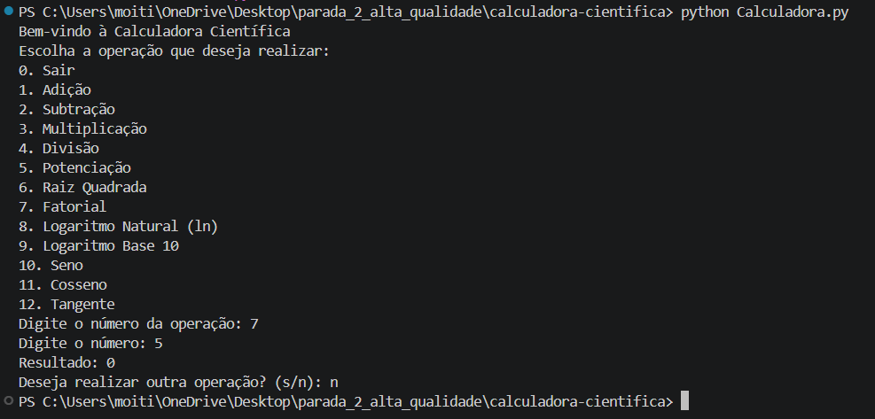

## Identificação do Bug

**Título do Bug:** O fatorial devolve zero para inteiros não negativos  
**Localização do Bug:** `Calculadora.py`, função `fatorial`, linhas 23–27, em particular a inicialização do ciclo na linha 25.

## Descrição Detalhada

**Descrição Clara do Bug:** O ciclo percorre `range(x+1)`, que começa em zero. Na primeira iteração, `fat *= 0` transforma o acumulador em zero, e as restantes multiplicações mantêm esse valor. Além disso, para um inteiro negativo o ciclo não é executado e a função devolve `1`, sem rejeitar a entrada.

**Contexto:** A opção 7 converte a entrada do utilizador para inteiro antes de chamar a função. Reproduzido com Python 3.12.3 e NumPy 2.5.4 no Windows.

## Passos para Reproduzir

**Passo a Passo Detalhado:**
1. Executar `python Calculadora.py`.
2. Escolher a opção `7` (Fatorial).
3. Introduzir `5`.
4. Responder `n` à pergunta sobre realizar outra operação.

**Consistência:** Consistente para valores inteiros não negativos; valores negativos também não são validados corretamente.

## Resultado Esperado vs. Obtido

**Resultado Esperado:** Para a entrada `5`, apresentar `120`; para a entrada `0`, apresentar `1`.

**Resultado Obtido:** Para `5`, apresenta `0`. Testes diretos também devolveram `fatorial(0) = 0`; para inteiros negativos, a função devolve `1`.

## Evidências

**Screenshots:** 

**Logs de Erro:** Teste direto: `fatorial(5) = 0`; `fatorial(0) = 0`. Não foi observada exceção.

## Severidade e Impacto

**Severidade do Bug:** Alta.

**Impacto do Bug:** A operação de fatorial apresenta resultados errados para os casos válidos e não rejeita entradas negativas. Qualquer cálculo que dependa do resultado fica comprometido.

## Sugestões para Correção (Opcional)

**Possíveis Soluções:** Iterar de `1` até `x` inclusive, manter `fatorial(0) = 1` e rejeitar valores negativos.

## Registro e Acompanhamento

**Data de Identificação:** 06/11/2026

**Status do Bug:** Não resolvido
