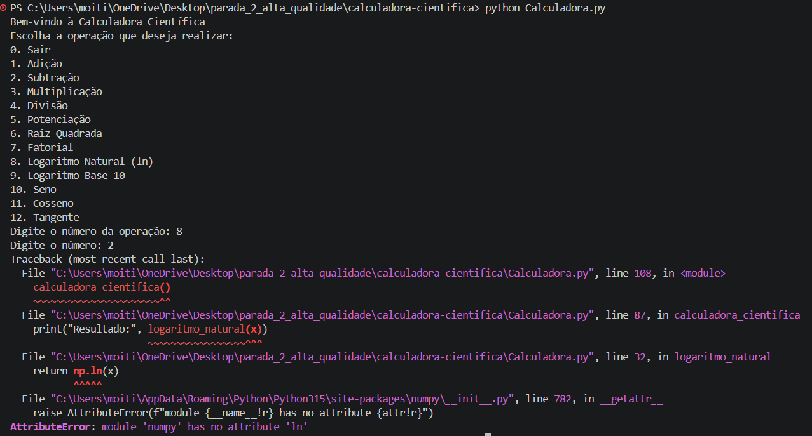

## Identificação do Bug

**Título do Bug:** O logaritmo natural falha por chamar `np.ln`  
**Localização do Bug:** `Calculadora.py`, função `logaritmo_natural`, linha 32.

## Descrição Detalhada

**Descrição Clara do Bug:** A implementação chama `np.ln(x)`, atributo que não existe no módulo NumPy. Para um argumento positivo, a função lança `AttributeError` em vez de calcular e apresentar o logaritmo natural.

**Contexto:** Reproduzido com Python 3.12.3 e NumPy 2.5.4 no Windows; `hasattr(np, "ln")` devolve `False`.

## Passos para Reproduzir

**Passo a Passo Detalhado:**
1. Executar `python Calculadora.py`.
2. Escolher a opção `8` (Logaritmo Natural).
3. Introduzir `2`.

**Consistência:** Consistente para valores positivos que chegam à linha 32.

## Resultado Esperado vs. Obtido

**Resultado Esperado:** Apresentar o logaritmo natural de 2, aproximadamente `0.693147`.

**Resultado Obtido:** A execução termina com `AttributeError: module 'numpy' has no attribute 'ln'`.

## Evidências

**Screenshots:** 

**Logs de Erro:** `AttributeError: module 'numpy' has no attribute 'ln'` em `Calculadora.py`, linha 32 (`return np.ln(x)`).

## Severidade e Impacto

**Severidade do Bug:** Alta.

**Impacto do Bug:** A operação de logaritmo natural não pode ser concluída para valores positivos e a exceção interrompe o programa.

## Sugestões para Correção (Opcional)

**Possíveis Soluções:** Usar `np.log(x)` (logaritmo natural em NumPy) ou `math.log(x)`.

## Registro e Acompanhamento

**Data de Identificação:** 06/11/2026

**Status do Bug:** Não resolvido
