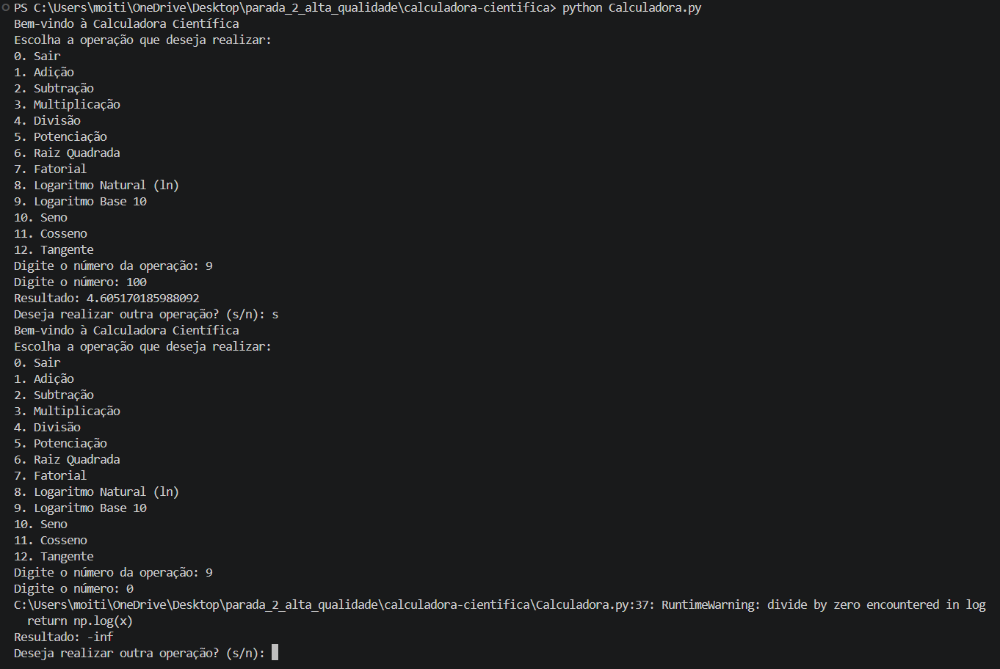

## Identificação do Bug

**Título do Bug:** A opção “Logaritmo Base 10” calcula ln e aceita zero  
**Localização do Bug:** `Calculadora.py`, função `logaritmo_base10`, linhas 34–37.

## Descrição Detalhada

**Descrição Clara do Bug:** A função usa `np.log(x)`, que calcula o logaritmo natural, não o logaritmo de base 10. A validação também só rejeita `x < 0`; para `x = 0`, a função devolve `-inf` e emite um aviso de divisão por zero.

**Contexto:** Reproduzido com Python 3.12.3 e NumPy 2.5.4 em Linux. Foram testados os valores 100 e 0.

## Passos para Reproduzir

**Passo a Passo Detalhado:**
1. Executar `python Calculadora.py`.
2. Escolher a opção `9` (Logaritmo Base 10).
3. Introduzir `100` e verificar o resultado.
4. Repetir a operação, introduzir `0` e verificar o resultado e os avisos.

**Consistência:** Consistente: para entradas positivas calcula ln; para zero devolve `-inf` e emite um aviso.

## Resultado Esperado vs. Obtido

**Resultado Esperado:** Para `100`, apresentar `2`. Para `0`, apresentar uma mensagem controlada de erro de domínio, sem devolver um resultado numérico inválido.

**Resultado Obtido:** Para `100`, apresenta aproximadamente `4.605170185988092` (ln(100)). Para `0`, apresenta `-inf` e emite `RuntimeWarning: divide by zero encountered in log`.

## Evidências

**Screenshots:** 

**Logs de Erro:** `logaritmo_base10(100) = 4.605170185988092`; `logaritmo_base10(0) = -inf`; `RuntimeWarning: divide by zero encountered in log` em `Calculadora.py`, linha 37.

## Severidade e Impacto

**Severidade do Bug:** Alta.

**Impacto do Bug:** Os resultados da função são incorretos para entradas positivas e zero não é tratado como valor fora do domínio. Pode induzir o utilizador em erro e propagar valores inválidos.

## Sugestões para Correção (Opcional)

**Possíveis Soluções:** Rejeitar `x <= 0` e usar `np.log10(x)` ou `math.log10(x)`.

## Registro e Acompanhamento

**Data de Identificação:** 06/11/2026

**Status do Bug:** Não resolvido
