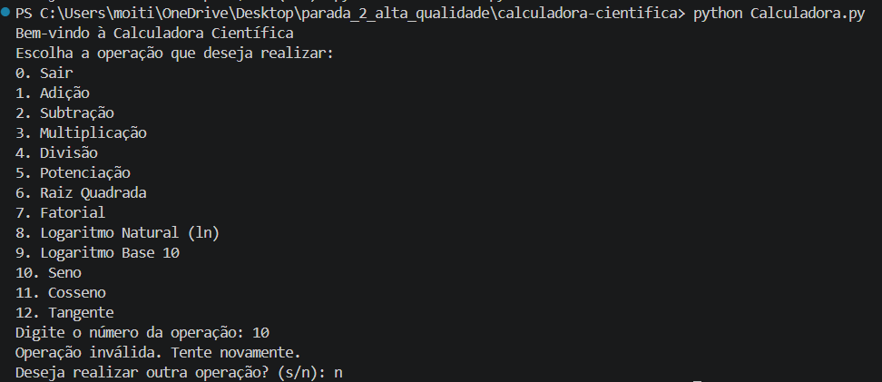

## Identificação do Bug

**Título do Bug:** A opção de seno está no menu, mas não está implementada  
**Localização do Bug:** `Calculadora.py`, opção 10 anunciada na linha 52; despacho em `calculadora_cientifica`, linhas 63–102, sem ramo para a escolha '10'.

## Descrição Detalhada

**Descrição Clara do Bug:** O menu apresenta a opção “10. Seno”, mas o fluxo de controlo não contém um caso que processe essa escolha. O programa trata-a como opção inválida e não solicita o ângulo nem calcula o seno.

**Contexto:** O menu anuncia ângulos em graus para operações trigonométricas. A implementação deve, portanto, considerar a conversão de graus para radianos.

## Passos para Reproduzir

**Passo a Passo Detalhado:**
1. Executar `python Calculadora.py`.
2. Escolher a opção `10` (Seno).
3. Observar a resposta do programa.
4. Responder `n` quando for perguntado se pretende realizar outra operação.

**Consistência:** Consistente sempre que a opção `10` é escolhida.

## Resultado Esperado vs. Obtido

**Resultado Esperado:** Solicitar o ângulo e apresentar o seno correspondente.

**Resultado Obtido:** Apresenta `Operação inválida. Tente novamente.` e não calcula o seno.

## Evidências

**Screenshots:**

**Logs de Erro:** Saída observada: `Operação inválida. Tente novamente.` Não foi observada exceção.

## Severidade e Impacto

**Severidade do Bug:** Média.

**Impacto do Bug:** Uma das operações anunciadas no menu não está disponível, deixando incompleta a funcionalidade de calculadora científica.

## Sugestões para Correção (Opcional)

**Possíveis Soluções:** Adicionar o ramo para a opção 10 e uma função de seno, convertendo o ângulo de graus para radianos se essa for a unidade de entrada.

## Registro e Acompanhamento

**Data de Identificação:** 06/11/2026

**Status do Bug:** Não resolvido
