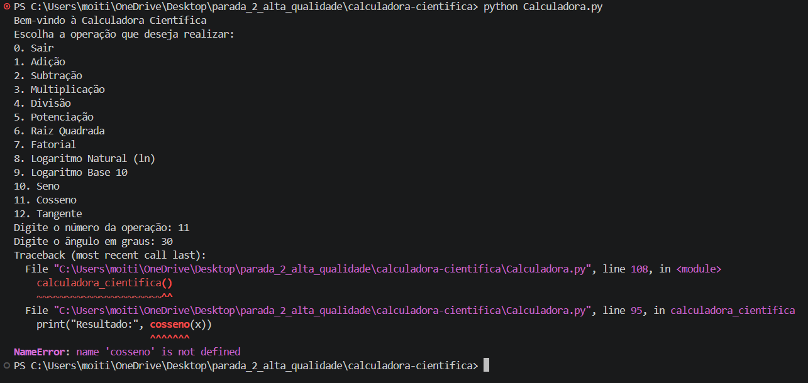

## Identificação do Bug

**Título do Bug:** A opção de cosseno termina com `NameError`  
**Localização do Bug:** `Calculadora.py`, chamada `cosseno(x)` na linha 95; não existe definição da função `cosseno` no ficheiro.

## Descrição Detalhada

**Descrição Clara do Bug:** A opção 11 chama uma função que não foi definida. Ao selecionar cosseno, o programa lança `NameError` e termina sem apresentar resultado.

**Contexto:** Reproduzido com Python 3.12.3 e NumPy 2.5.4 em Linux. O menu pede o ângulo em graus.

## Passos para Reproduzir

**Passo a Passo Detalhado:**
1. Executar `python Calculadora.py`.
2. Escolher a opção `11` (Cosseno).
3. Introduzir `30` quando solicitado o ângulo em graus.

**Consistência:** Consistente sempre que a opção 11 é escolhida.

## Resultado Esperado vs. Obtido

**Resultado Esperado:** Apresentar o cosseno de 30°, aproximadamente `0.8660254`.

**Resultado Obtido:** O programa termina com `NameError: name 'cosseno' is not defined`.

## Evidências

**Screenshots:**

**Logs de Erro:** `NameError: name 'cosseno' is not defined` na linha 95, na chamada `cosseno(x)`.

## Severidade e Impacto

**Severidade do Bug:** Média.

**Impacto do Bug:** A funcionalidade de cosseno fica indisponível e a exceção encerra a execução da calculadora.

## Sugestões para Correção (Opcional)

**Possíveis Soluções:** Definir a função de cosseno e converter o ângulo de graus para radianos antes do cálculo.

## Registro e Acompanhamento

**Data de Identificação:** 06/11/2026

**Status do Bug:** Não resolvido
