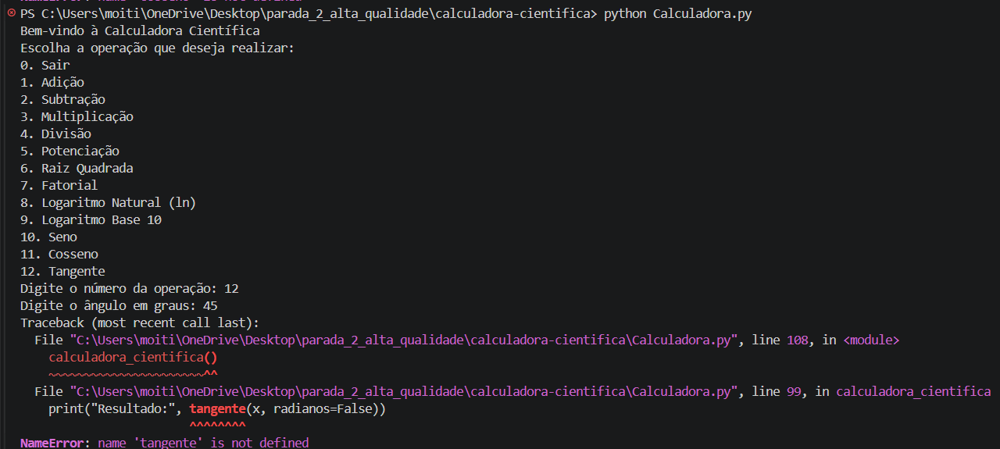

## Identificação do Bug

**Título do Bug:** A opção de tangente termina com `NameError`  
**Localização do Bug:** `Calculadora.py`, chamada `tangente(x, radianos=False)` na linha 99; não existe definição da função `tangente` no ficheiro.

## Descrição Detalhada

**Descrição Clara do Bug:** A opção 12 tenta chamar uma função não definida. O programa lança `NameError` antes de apresentar qualquer resultado.

**Contexto:** Reproduzido com Python 3.12.3 e NumPy 2.5.4 em Linux. O menu pede o ângulo em graus.

## Passos para Reproduzir

**Passo a Passo Detalhado:**
1. Executar `python Calculadora.py`.
2. Escolher a opção `12` (Tangente).
3. Introduzir `45` quando solicitado o ângulo em graus.

**Consistência:** Consistente sempre que a opção 12 é escolhida.

## Resultado Esperado vs. Obtido

**Resultado Esperado:** Apresentar a tangente de 45°, aproximadamente `1`.

**Resultado Obtido:** O programa termina com `NameError: name 'tangente' is not defined`.

## Evidências

**Screenshots:**

**Logs de Erro:** `NameError: name 'tangente' is not defined` na linha 99, na chamada `tangente(x, radianos=False)`.

## Severidade e Impacto

**Severidade do Bug:** Média.

**Impacto do Bug:** A funcionalidade de tangente fica indisponível e a exceção encerra a execução. Também não existe tratamento para ângulos em que a tangente não está definida.

## Sugestões para Correção (Opcional)

**Possíveis Soluções:** Definir a função, respeitar a unidade indicada pelo argumento `radianos` e tratar ângulos em que a tangente não está definida.

## Registro e Acompanhamento

**Data de Identificação:** 06/11/2026

**Status do Bug:** Não resolvido
