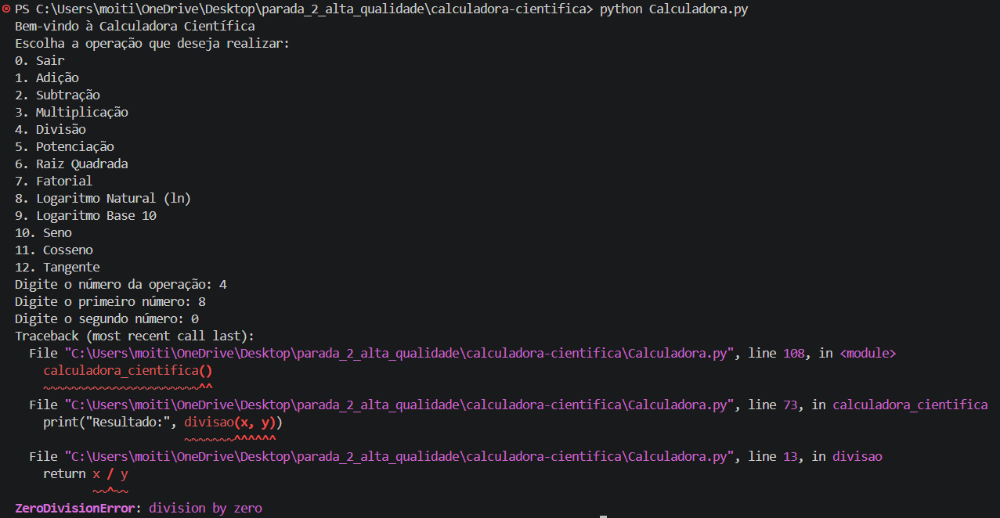
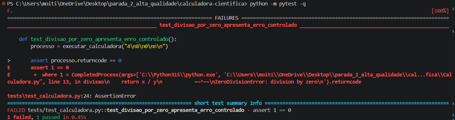
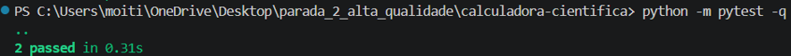

## Identificação do Bug

**Título do Bug:** A divisão por zero encerra o programa com exceção  
**Localização do Bug:** `Calculadora.py`, função `divisao`, linha 13; chamada no ramo da opção 4, linha 73.

## Descrição Detalhada

**Descrição Clara do Bug:** A função divide diretamente `x / y` sem verificar se o denominador é zero. Quando o utilizador introduz zero, ocorre `ZeroDivisionError` e o processo termina com traceback.

**Contexto:** Reproduzido com Python 3.12.3 e NumPy 2.5.4 no Windows, usando entradas convertidas para `float`.

## Passos para Reproduzir

**Passo a Passo Detalhado:**
1. Executar `python Calculadora.py`.
2. Escolher a opção `4` (Divisão).
3. Introduzir `8` como primeiro número.
4. Introduzir `0` como segundo número.

**Consistência:** Consistente para denominador `0.0`.

## Resultado Esperado vs. Obtido

**Resultado Esperado:** Apresentar uma mensagem controlada a indicar que a divisão por zero não é permitida, sem encerrar abruptamente o programa.

**Resultado Obtido:** O programa termina com `ZeroDivisionError: float division by zero`.

## Evidências

**Screenshots:** 

**Logs de Erro:** `ZeroDivisionError: float division by zero` em `Calculadora.py`, linha 13, na expressão `return x / y`.

Na fase Red, com o teste de regressão e o código original, pytest reportou `1 failed, 1 passed`; o teste de divisão por zero falhou devido a `ZeroDivisionError: float division by zero`, em `Calculadora.py`, linha 13. O teste de divisão normal passou.

Após a correção, a fase Green reportou `2 passed` com pytest 7.1.3. Os testes verificam a mensagem controlada para divisão por zero e confirmam que a divisão normal continua correta.

## Severidade e Impacto

**Severidade do Bug:** Média.

**Impacto do Bug:** Uma entrada inválida provocava o encerramento abrupto da calculadora e impedia a continuidade da utilização. A correção trata o denominador zero sem alterar o resultado de divisões válidas.

## Sugestões para Correção (Opcional)

**Possíveis Soluções:** A função `divisao(x, y)` verifica `y == 0` e lança `ValueError("Divisão por zero não permitida.")`. O ramo da opção 4 captura essa exceção e apresenta a mensagem ao utilizador.

**Documentação da correção TDD:** Foi criado `tests/test_calculadora.py` com dois testes de integração: um para divisão por zero e outro para divisão válida. Primeiro, os testes foram executados contra a cópia do código original (Red): um falhou pelo `ZeroDivisionError` esperado e um passou. Depois da alteração mínima (Green), ambos passaram. Comando utilizado: `python -m pytest -q`.

**Refatoração e verificação:** Não foi necessária refatoração adicional. A suíte relacionada foi executada depois da correção e terminou com `2 passed`. A revisão de código por colegas ainda não foi realizada.

## Registro e Acompanhamento

**Data de Identificação:** 06/11/2026. Atualização do relatório: 07/11/2026.

**Status do Bug:** Resolvido. Correção aplicada e testes TDD executados com sucesso no repositório original.
